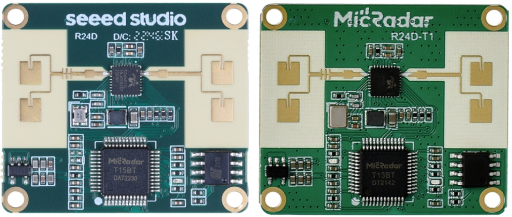
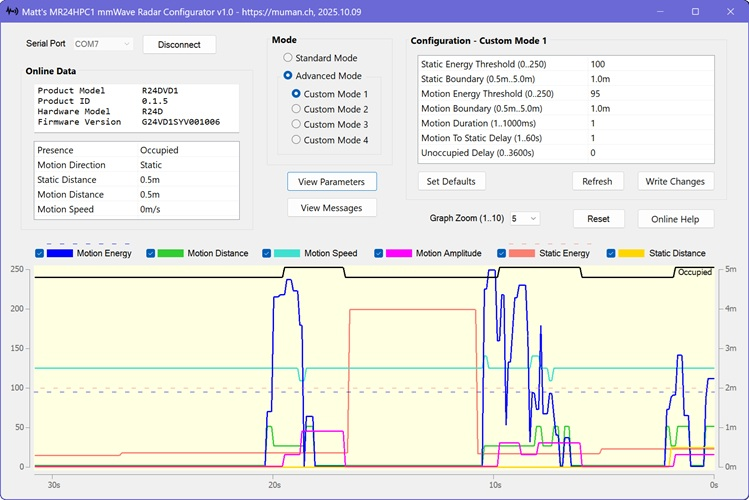
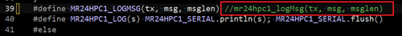

# Arduino Library for Seeed Studio MR24HPC1 25GHz mmWave Sensor

The "MR24HPC1 24GHz mmWave Sensor Human Static Presence Module Lite" from Seeed Studio has a detection range of up to 5m. 

It runs only on 5V, 3.3V cannot be used. Communications uses a proprietary binary serial protocol at a fixed speed of 115200 baud. 



The board uses the ICLEGEND S3KM111L mmWave radar chip. It also contains a MicRadar T15BT, a 32-bit microcontroller which provides the communications. "_The MicRadar T15BT is an integrated 24GHz mmWave radar sensor and Bluetooth/Wi-Fi combo module that uses the ICLEGEND Micro S3KM111L radar System-on-Chip (SoC)._" So BT = Bluetooth.

The T15BT is not wired for Bluetooth, there's no antenna. (Seeed Studio does have a "Sensor Kit" that uses Bluetooth and WiFi, but this has a XIAO microcontroller to manage the Bluetooth and WiFi communications.)

There is a very similar mmWave board from MicRadar, called the R24DVD1 (the right-hand picture above). This uses a slightly different communications protocol. I'll probably do a library for the MicRadar version because there don't seem to be any libraries for this board yet.

Strangely, the ProductModel reported by the Seeed Studio MR24HPC is "R24DVD1", which is the name of MicRadar product.

> [!NOTE]
> There's another _mumanchu_ library for the cheaper C4001 mmWave sensors (12m and 25m range) from DFRobot, \
> https://github.com/mumanchu/C4001mmWave


<!-- ========================================================================================== -->

## Contents

- [Summary from the User Manual](#summary)
- [Detecting the Occupied/Unoccupied State](#occupied-state)
- [Connecting the Module to the Microcontroller](#connecting-the-module)
- [Configuring the Sensor](#configuration)
- [Windows Application](#windows-application)
- [Class Reference](#class-reference)
- [Example Sketch](#example-sketch)
- [Why Use This Library?](#advantages)
- [Updating the Firmware](#firmware-update)
- [References](#references)
- [Revision History](#revision-history)


<!-- ========================================================================================== -->

<a name="summary"></a>
## Summary from the User Manual

The Seeed Studio documentation is not easy to understand, so here is a "brief" summary...

The sensor transmits a complex 24GHz band millimetre-wave radar signal and receives the reflections. A powerful on-board microcontroller processes the reflected signal and determines human presence, distance and motion according to certain preset or configured parameters. It detects large movements (motion) and also the very small movements (static) made by a person standing, sitting or lying down. It detects the micro-motion of breathing and other tiny movements. More expensive modules can even detect beating hearts.

Because it's radar, it can "see through" some objects, clothes, thin walls and windows. For this reason it can be configured to reject signals below a certain intensity (energy level) or a certain distance (boundary). The module can be mounted inside a thin plastic enclosure, such as a surveillance camera enclosure, which is transparent to the radar signals.

Metal objects are not transparent to the radar signals and are highly reflective. Vibrating metal objects such as fans and air conditioning units can cause the reflected signal to be misinterpreted. There are several configuration parameters which can be used to reduce the effects of this noise. People wearing clothes are less reflective than solid static objects, which is why motion is used to detect human presence. (You should use the "Bedroom" and "Bathroom" presets if the targets are not wearing clothes :-)

The radar signal is a cone, which means that it behaves best when mounted on the ceiling, with sensitivity varying from the edge to the centre of the cone. This reflected signal is a "radius" rather than a straight-line distance, and I suspect all the distances are actually radiuses too (or 'radii'). It can be mounted under a chair or a bed because the radar signal passes through the cushions or mattress. Mounting on a wall is possible too, where it will be able to detect humans moving about on the ceiling, but if you don't need that feature then half of the radar's field-of-vision will not be usable.

The power supply quality is very important, they even supply a couple of circuit diagrams. Minimum 100mA ripple is required, with a good GND connection. I used 5V from the USB, or 5V from the microcontroller board, and did not have any problems - but the wire length was very short. If the sensor is a long way from the microcontroller, you will probably need a local 5V power supply.

The module has two digital (5V/0V on/off) outputs. Output S1 is high (5V) if "Occupied" when a person or persons are detected. Output S2 is high (5V) when motion is detected. There are also 4 general-purpose outputs GP1..GP4, but these are undocumented - it would have been nice if these were available.

The board has two configuration modes. _Standard Function Mode_ uses a _Scene Preset_ to select ranges and energy levels for four standard environments (rooms), along with a _Sensitivity_ distance and an _Unoccupied Delay_ (10s..60mins). _Advanced Mode_, confusingly called _Underlying Open Function Mode_ in the manual, allows a much more detailed configuration, with programmable energy thresholds, distance ranges and timing. 

Once configured, the module can be used stand-alone if the S1 (Occupied/Unoccupied) and S2 (Motion/No Motion) outputs are sufficient. Alternatively, the serial connection or USB can be used to supply real-time data, or it can be connected to a microcontroller to provide Bluetooth or WiFi communications with a server.

During normal operation, the sensor sends unsolicited _Report_ messages on its TX line. In Standard Mode these are sent only when a state changes. In Advanced Mode, an additional status message is sent twice-a-second, with extra data for logging or graphical traces.


<!-- ========================================================================================== -->

<a name="occupied-state"></a>
## Detecting the Occupied/Unoccupied State

The module does many mysterious things, but in the end it all boils down to the 'Occupied' and 'Unoccupied' states. This is how the documentation describes it.

The state is 'Occupied' when _motion_ (a moving person) or _static presence_ (a stationary person) is detected. Could 'person' be an animal or any moving object? This is not clear.

1) To detect motion, the following conditions must be satisfied:

- The 'Motion Energy' reading must be greater than the 'Motion Energy Threshold' setting.
- The 'Motion Distance' reading must be within the 'Motion Boundary' setting.
- If these two conditions are not met, the 'moving' state will lapse after the 'Motion To Static Delay' period and it will switch to 'static presence' detection.

2) To detect static presence, these conditions must be satisfied:

- The 'Static Energy' reading must be greater than the 'Static Energy Threshold' value.
- The 'Static Distance' must be within the 'Static Boundary' setting.
- If these conditions are not met, the 'Occupied' state will revert to 'Unoccupied' after the 'Unoccupied Delay' period.

When 'Unoccupied', if motion or static presence is again detected, it goes to step 1 or 2.

_But I must say that it does not behave in exactly this way when I observe the states in the MR24HPC1.exe App's graphical view..._


<!-- ========================================================================================== -->

<a name="connecting-the-module"></a>
## Connecting the Module to the Microcontroller

> [!CAUTION]
> This module runs at 5V! DO NOT connect it directly to 3.3V a microcontroller unless the microcontroller has 5V-tolerant GPIOs! Also note that NOT ALL GPIOs are 5V-tolerant, so check the data sheet very carefully. \
> For a 3.3V MCU, you could put a 10K ohm current-limiting resistor between the sensor's TX output and the MCU's RX input, and also for the S1 and S2 signals if you use them. (See Disclaimer.)

A serial port which can run at 115200 baud is needed. The example sketch uses `Serial1` for the sensor, with `Serial` being used for the debug output to the Serial Monitor.

Because this library uses a `Stream` pointer, it can use either `HardwareSerial` or `SoftwareSerial`. 

A `HardwareSerial` port has fixed pins, which will probably be different for each microcontroller board. The standard pins are RX=Pin 0 and TX=Pin 1. Unfortunately this is usually the default `Serial` port which is used for the Serial Monitor, so these pins cannot be used for the mmWave sensor unless you use a different port for the Serial Monitor. The example sketch shows how to select the sensor's serial port for different MCUs. HardwareSerial *must* be used for slow microcontrllers with clocks less than 120MHz.

With `SoftwareSerial`, you can use almost any two GPIO pins for RX/TX. But SoftwareSerial _will not run_ at the required 115200 baud on many controllers. To use SoftwareSerial reliably at 115200 baud, and have time to do other things, you will need a _very fast_ 32-bit controller clocked at over 120MHz. On an STM32F103RB (72MHz) and it did not work, the max speed was 86400. On an STM32F407ZGT6 (168MHz), SoftwareSerial ran perfectly at 115200 baud.

**2mm Pin Spacing :-(**

The board's male 2 x 8 pin header for the UART connection has 2mm spacing. This is VERY annoying because the standard spacing is 2.54mm. Not many people have 2mm female connectors, so you'll probably have to buy some. It's not a good idea to force 2.54mm Dupont jumpers onto these smaller pins because they will be bent, and the connections are not reliable due to the smaller pin width (as I found out).


<!-- TODO diagram and photo -->


<!-- ========================================================================================== -->

<a name="configuration"></a>
## Configuring the Sensor

By default, the library does not enable the configuration methods. Add `#define MR24HPC1_ENABLE_CONFIGURATION` before `#include "MR24HPC1mmWave.h"` to enable the configuration methods, as shown in the example sketch.

At startup, the example sketch displays the current sensor configuration with `printParameters()`. Run this once to see what configuration you have. (Tip: You can put `return;` at the start of `loop()` so the display does not scroll up with multiple report messages.)

Configuration parameters are stored in nonvolatile memory on the sensor board. Once programmed they remain unchanged until they are re-programmed.

This means that you DO NOT need to re-program them in `setup()` every time the sketch runs. In fact, you should not do this, just program them once, then you don't need the configuration methods any more.

Parameters can either be programmed with a 'one-time programming sketch' which calls the `setXXX()` methods. Or they can be programmed using the Windows `MR24HPC1.exe` application described in the next section. You could do this with the Seeed Studio app described in the wiki, but (allegedly) it's a bit weird, and the "smoothed" analog-style graphical views make it hard to see what's happening. The _mumanchu_ app lets you see the correlation between the digital signals and sensor events.

The configuration parameters are described here in the _mumanchu_ MR24HPC1.exe configurator User Manual, \
https://muman.ch/muman/index.htm?muman-mr24hpc1-mmwave-sensor.htm#muman-mr24hpc1-parameters


<!-- ========================================================================================== -->

<a name="windows-application"></a>
## Windows Application, MR24HPC1.exe

A Windows application called `MR24HPC1.exe` has been developed to help with configuration, testing and visualisation. This application will help you understand the configuration parameters and sensor readings.




TODO

The full User Manual for the `MR24HPC1.exe` application is here, \
https://muman.ch/muman/index.htm?muman-mr24hpc1-mmwave-sensor.htm#muman-mr24hpc1-user-manual

The C# source code for this application (requires Visual Studio 2026 Community Edition) will soon be on github, but until then you can download the executable from here, \
https://muman.ch/muman/MR24HPC1.exe \

> [!INFORMATION]
> Windows will have the usual 'Windows Protected Your PC' fit if you try to download and run MR24HPC1.exe. It's very safe though, it does not use any internet connections or even write to the hard drive. So just press 'Run Anyway'.


An Arduino or other controller is _not needed_ to use the Windows application. The PC connects directly to the mmWave sensor using a _USB-to-5V-Serial Convertor_.


???
To use the _mumanchu_ MR24HPC1.exe or Seeed Studio configurators, you will need to convert the PC's USB communications to 5V TTL Serial.

The best converter to use is an FTDI TTL-232R-5V, but there are many suitable converters available. Make sure it's the 5V version, because a 3.3V version will not work and may be damaged.

**Using an Arduino Uno as a USB-to-serial converter**

The FTDI converter is quite expensive. But and old Arduino Uno can be used instead. These contain the same FTDI FT232 chip, or an equivalent, which does the same thing. To disable the Arduino microcontroller, connect the RESET pin to GND. This prevents the microcontroller from starting up, allowing the FT232 chip to be used for USB-to-TTL RX/TX communications. 

Connect the Arduino's 5V and GND to power the sensor, the RX (pin 0) to the sensors's TX, and TX (pin 1) to the sensor's RX.

Now run the _mumanchu_ MR24HPC1.exe or Seeed Studio configurator, select the COM port and press the "Connect" button.


TODO


<!-- ========================================================================================== -->

<a name="class-reference"></a>
## Class Reference

Descriptions of each method can found in the source code file [MR24HPC1mmWave.h](src/MR24HPC1mmWave.h). The descriptions are not duplicated here.

If you need to access an instance of this class from more than one .cpp file, split `MR24HPC1mmWave.h` into two files, one with the class definition (.h) and one with the code (.cpp).


```cpp
class MR24HPC1mmWave
{
public:
    // Initialised in begin(), normally 1
    uint protocolVersion;   // can be used if there are differences in the protocol

    // Data from Standard Mode reports
    uint presence;          // 0 = unoccupied/unknown; 1 = occupied
    uint motion;            // 0 = unoccupied/unknown; 1 = static person; 2 = moving person
    uint motionAmplitude;   // 0 = unoccupied; 1 = static person; 2..100 motion amplitude
    uint motionDirection;   // 0 = static; 1 = moving closer; 2 = moving away

    // Data from Underlying Open Function Mode mode reports
    uint staticEnergy;      // 0..250
    uint staticDistance;    // 0..8 in 0.5m steps (0..4m)
    uint motionEnergy;      // 0..250
    uint motionDistance;    // 0..6 in 0.5m steps (0..3m)
    uint motionSpeed;       // 0x00 = none, 0x01..0x09 = approaching, 0x0A = static, 
                            // 0x0B..0x14 = moving away, 0.5m/s steps
    ulong lastReportTime;   // time of last report message, including 'heartbeat'

    bool begin(Stream* stream);
    bool getProductInformation(char* productModel, char* productId, 
        char* hardwareModel, char* firmwareVersion, uint* protocolVersion);
    bool resetModule();
    bool getInitStatus(uint* initComplete);

    // Messages
    bool processReportMessage(bool* changed);
    bool receiveNextMessage(const byte* cmd = NULL);

    // The following methods are only needed for one-time configuration 
    #ifdef MR24HPC1_ENABLE_CONFIG

    // Standard Mode, also known as Scene Mode

    // Presets
    // note: new document has AREA and BEDROOM swapped AREA = 1, BEDROOM = 4
    // which version is correct?
    // sorted by 4/3.5/3/2.5? swap BATHROON & AREA, not BEDROOM & AREA
    // sets the 'detection radius'
    enum SCENE : uint
    {
        SCENE_NONE = 0,         // scene not set
        SCENE_LIVING_ROOM = 1,  // 4 .. 4.5m
        SCENE_BEDROOM = 2,      // 3.5 .. 4mm
        SCENE_BATHROOM = 3,     // 2.5 .. 3m
        SCENE_AREA = 4          // 3 .. 3.5m
    };
    bool setScene(SCENE scene);
    bool getScene(SCENE* scene);
    bool setSensitivity(uint sensitivity);
    bool getSensitivity(uint* sensitivity);

    bool setUnoccupiedDelay(uint unoccupiedDelay);
    bool getUnoccupiedDelay(uint* unoccupiedDelay);
    bool getPresence(uint* presence);
    bool getMotion(uint* motion);
    bool getMotionAmplitude(uint* motionAmplitude);
    bool getMotionDirection(uint* motionDirection);

    // Underlying Open Function Mode (i.e. Advanced mode)
    bool setOpenFunctionMode(bool openFunctionMode);
    bool getOpenFunctionMode(bool* openFunctionMode);
    bool getStaticEnergy(uint* staticEnergy);
    bool getMotionEnergy(uint* motionEnergy);
    bool getStaticDistance(uint* staticDistance);
    bool getMotionDistance(uint* motionDisatnce);
    bool getMotionSpeed(uint* motionSpeed);

    // Custom Mode, allows a more detailed configuration
    bool setCustomMode(uint customMode);
    bool getCustomMode(uint* customMode);
    bool saveCustomMode();
    bool setStaticEnergyThreshold(uint threshold);
    bool getStaticEnergyThreshold(uint* threshold);
    bool setStaticBoundary(uint boundary);
    bool getStaticBoundary(uint* boundary);
    bool setMotionEnergyThreshold(uint threshold);
    bool getMotionEnergyThreshold(uint* threshold);
    bool setMotionBoundary(uint boundary);
    bool getMotionBoundary(uint* boundary);
    bool setMotionDuration(ulong milliseconds);
    bool getMotionDuration(ulong* milliseconds);
    bool setMotionToStaticDelay(ulong milliseconds);
    bool getMotionToStaticDelay(ulong* milliseconds);
    bool setCustomUnoccupiedDelay(ulong milliseconds);
    bool getCustomUnoccupiedDelay(ulong* milliseconds);

    // Conversion functions
    // centimetres (cm) are used so we don't need float
    uint convertUnoccupiedDelayToSeconds(uint unoccupiedDelay);
    uint convertSensitivityToCm(uint sensitivity);
    uint convertDistanceToCm(uint distance);
    int convertMotionToCmPerSecond(uint motion);

#ifdef DEBUG
    void printParameters();
#endif
    #endif      // #ifdef MR24HPC1_ENABLE_CONFIG
};
```


<!-- ========================================================================================== -->

<a name="example-sketch"></a>
## Example Sketch

[MR24HPC1mmWave-Example.ino](examples/MR24HPC1mmWave-Example/MR24HPC1mmWave-Example.ino)

`#define DEBUG`


`#define MR24HPC1_ENABLE_CONFIG`


displays the configuration at startup

underlying thingy mode


loop()
polls for report messages
detects if the sensor is not responding, no messages received for > 1 minute , uses 'heartbeat' message


**Hiding the hex messages**

message dipslay in hex, can be disablde by




<!-- ========================================================================================== -->

<a name="advantages"></a>
## Why Use This Library?

There are only a couple of other minimalist MR24HPC1 libraries out there, but this library has several advantages...

- It contains methods to configure _all_ the sensor's parameters, but only if you `#define MR24HPC1_ENABLE_CONFIG`.

- Optionally displays all sent and received messages in Hex. This is very useful for testing and understanding the binary protocol.

- Has debug code to display the entire current configuration, see `printParameters()`.

- Uses a state machine to receive and validate messages from the sensor. This is important because the sensor sends unsolicited report messages, which can be confused with the response to a command. 

- Because this library uses a `Stream` pointer, it can use either `HardwareSerial` (`Uart`) or `SoftwareSerial`. With SoftwareSerial you can use almost any two GPIO pins to connect to the sensor, but you need a very fast microcontroller (120MHz or faster) to achieve 115200 baud.

- There is a _mumanchu_ [Windows Application](#windows-application) called `MR24HPC1.exe` to help with the configuration, testing and visualisation.

- The library source code in `MR24HPC1mmWave.h` contains useful comments describing what each method does, and why.

- It's been tested on STM32, SAMD, AVR, ESP32 and ESP8266 microcontrollers.


<!-- ========================================================================================== -->

<a name="firmware-update"></a>
## Updating the Firmware

The mmWave module may contain an old version of its firmware. Check this by running the example sketch to display the version number. 

The latest firmware version is (currently) G24VD1SYV001006. Check the Seeed Studio wiki for the latest version. The firmware should be updated if it's older.


<!--
TODO can a cheap ST-LINK device be used?
TODO use STM-Cube programmer and ST-LINK/V2 USB ??
TODO nake adapter cable for standard SWD
-->


The Seeed Studio Wiki contains a detailed section on updating the firmware via the SWD/J-TAG pins, but this requires the very expensive "J-Link Programmer" to do the job, which can only be afforded by professionals. However, I managed to upgrade the firmware using the far cheaper "J-Link EDU Mini" version with the free "SEGGER J-Flash Lite" application. At CHF60, the J-Link EDU Mini version is about one-tenth the cost of the professional version.

First I had to download the "Pack_Segger_AT32F4xx_v1.3.3.zip" file and run "Segger_AT32F4xx_AddOn.exe" to add the AT32F4xx devices to the J-Link database for J-Flash to use. Device 'AT32F403ARGT7' must be selected as the target.

It's also possible to update the firmware via the serial port using their own "PackageMake" application (download "PackageMake-v1.1.1.zip"), but that only works for later versions of the firmware. I have not tried this.

I must say that I'm always very dubious about running unsigned Chinese software on my computer. Why don't they Sign their software? Are they not able to get a Software Signing Certificate?

The firmware version I am using is G24VD1SYV001006, from file "Jlink_MR24HPC1-20230302.bin" which was downloaded from the Seeed Studio wiki page (link in References section). They have not released a new version since March 2023, so they have probably stopped further development of this old product.


<!-- ========================================================================================== -->

<a name="references"></a>
## References

**Seeed Studio MR24HPC1 Wiki** \
https://wiki.seeedstudio.com/Radar_MR24HPC1/

**MR24HPC1 User Manual V1.5 (no date)** \
https://files.seeedstudio.com/wiki/mmWave-radar/MR24HPC1_User_Manual-V1.5.pdf

**Slightly Different User Manual (2022)** \
https://files.seeedstudio.com/wiki/mmWave-radar/24GHz_mmWave_Sensor-Human_Static_Presence_Module_Lite_User_Manual.pdf

**MR24HPC1 Data Sheet (2023)** \
https://files.seeedstudio.com/wiki/mmWave-radar/24GHz_mmWave_Sensor-Human_Static_Presence_Module_Lite_Datasheet.pdf

**IcLegend S3KM111L Brochure** \
https://edworks.co.kr/wp-content/uploads/2023/10/S3KM111L_Brochure.pdf

**Seeed Studio MR24HPC1 Library** \
This library is linked from their wiki page \
https://github.com/limengdu/Seeed_24GHz_Human_Static_Presence_Module_Lite

**The Other MR24HPC1 Library** \
This one's even bigger than mine!
https://github.com/taunoe/mr24hpc1-radar

**Visual Micro ** \
Recommended for developing Arduino apps using Microsoft Visual Studio 2026 Community Edition \
This combination provides excellent editing and debug features! \
https://www.visualmicro.com/


<!-- ========================================================================================== -->

<a name="revision-history"></a>
## Revision History

| Date       | Version  | Notes        |
|:---------- |:---------| :----------- |
| 2026.11.13 | 0.0.0    | Preliminary  |


<br/>

## Joke of the Week 

Did you sleep well? \
_I don't know, I was asleep._

© mumanchu 2026


